  

# kuration-wrapper-and-guide

Runnable notebooks and operator reference for solutions built on the [Kuration SDK](https://github.com/aintropy-ai/kuration-sdk).

## What's in here

- **[`notebooks/`](./notebooks/)**. One-click Binder and Colab launchers. Zero setup. The SDK is pre-installed in the launched environment.
- **[`solutions-guide/`](./solutions-guide/)**. Operator reference and design notes migrated from `kuration-ai/solutions-guide`.

Long-form blog posts on physical-AI data curation live on [aintropy.ai/blog](https://aintropy.ai/blog), published directly from Drive through the content pipeline.

## Try any of it in a browser

Every notebook has a Colab and a Binder badge. Click, wait, run.

> **Launcher status.** The URLs below point at `aintropy-solutions/beta-solutions`. Colab and Binder can only clone public repositories, so the badges activate once this repo goes public. In the meantime, clone and run any notebook locally with `pip install kuration-sdk[gameplay]`.

| Notebook | Launch |
|---|---|
| `action-state-consistency.ipynb` |   |
| `collision-aware.ipynb` |   |
| `coverage-based-curation.ipynb` |   |

## Contributing

See the [contributing guide](../CONTRIBUTING.md) at the repo root.

## License

[Apache 2.0](../LICENSE).
