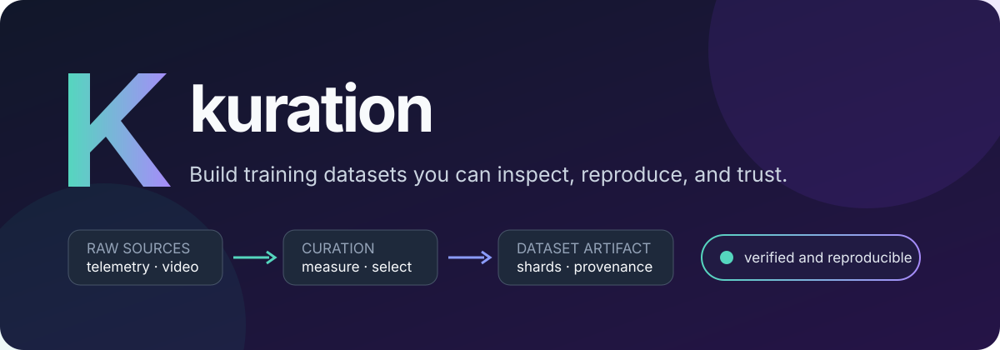

<p align="center">
  
</p>

# kuration-sdk

**Build reproducible training datasets from time-series, telemetry, trajectories, and
synchronized video.** Kuration segments raw sources, measures what matters, selects a useful
subset, and writes verified training shards with the decisions needed to reproduce them.

```python
from kuration import input

dataset = (
    input("sessions/*.parquet", time="timestamp", entity="device")
    .window(4, stride=2, unit="seconds")
    .measure("activity", "std", of="signal")
    .measure("fault_rate", "rate", of="fault")
    .bin("activity", bins=8)
    .bin("fault_rate", bins=4)
    .split(test=0.1)
    .sample("equal", n=5_000)
    .options(mode="strict", seed=7)
)

print(dataset.explain().render())
dataset.output("out/training-v1", preset="numpy-timeseries")
```

The result is not just a directory of arrays. It is a portable dataset artifact with train/test
shards, source identity, selection metadata, a resolved configuration, component provenance,
and SHA-256 integrity metadata.

## Why teams use kuration

| Need | What kuration provides |
|---|---|
| Make a large corpus trainable | Count- or duration-budget selection over fixed or overlapping windows |
| Preserve useful diversity | Quantile bins, tag coverage, weighted ranking, filters, and feature-space methods |
| Avoid train/test leakage | Source- and group-aware deterministic splits |
| Understand what changed | Input previews, candidate-versus-selected review, artifact comparison, and static HTML reports |
| Resume long runs safely | Atomic writes, complete run fingerprints, and checksum-verified shard reuse |
| Add domain intelligence | Discoverable operators, metrics, scorers, adapters, transforms, encoders, and presets |
| Move from laptop to scale | Streaming sources, bounded Arrow checkpoints, process workers, cloud paths, and optional Ray execution |

<p align="center">
  
</p>

## Try it in five minutes

The repository includes a deterministic, download-free sensor example using only NumPy:

```bash
python -m pip install -e .
python examples/quickstart.py --out quickstart-out
kur-inspect quickstart-out --verify
```

It creates six tiny sessions, scores 42 candidate windows, selects 12 across activity and fault
patterns, writes train/test NPZ shards, and reads one back. Follow the
**[guided quickstart](docs/quickstart.md)** for the operator-by-operator explanation.

Install capabilities only when a pipeline needs them:

```bash
python -m pip install -e '.[methods,parquet]'  # selection methods + Parquet
python -m pip install -e '.[video]'            # PyAV video frames
python -m pip install -e '.[ray]'              # distributed source execution
python -m pip install -e '.[all]'              # every runtime integration
```

`pipeline.explain()` reports the extras required by a planned run before it reads the full
dataset.

## A dataset you can inspect and defend

```text
out/training-v1/
├── config.json                 # resolved job, pipeline, versions, and provenance
├── dataset_manifest.json       # shard index, splits, shapes, sizes, and SHA-256
├── train/
│   └── <source>_<entity>_<hash>_shard0000.npz
└── test/
    └── <source>_<entity>_<hash>_shard0000.npz
```

```bash
kur-inspect out/training-v1 --verify
kur-diff out/training-v0 out/training-v1
kur-check out/training-v1 --policy quality.json
```

- Selection is deterministic across supported worker counts and executors.
- `resume=True` reuses a shard only when its prior byte size and SHA-256 still match.
- Jobs, artifact formats, and installed components are versioned and fail loudly when
  incompatible.
- Every optional integration remains outside the NumPy-only core.

## Operators: package a curation decision

Operators turn a reviewed sequence of normal pipeline steps into a named, validated component:

```python
from kuration import register_operator

@register_operator(
    "acme/balance-signal",
    description="Balance windows by signal variability",
    parameters={
        "type": "object",
        "properties": {
            "field": {"type": "string"},
            "bins": {"type": "integer", "minimum": 2},
        },
        "required": ["field"],
        "additionalProperties": False,
    },
    version="1",
)
def balance_signal(pipeline, *, field, bins=8):
    return (pipeline
            .measure("signal_variability", "std", of=field)
            .bin("signal_variability", bins=bins))

pipeline = pipeline.apply("acme/balance-signal", field="signal", bins=6)
```

The parameter contract is checked when the operator is added. The named call, descriptor, code
fingerprint, and expanded ordinary operations are retained in provenance. For computation over
whole windows or video frames, pair an operator with a registered bounded batch transform.

See **[Building operators](docs/operators.md)** for compositional, transform-backed, testing,
discovery, and packaging examples, or run
[`examples/05_custom_operators.py`](examples/05_custom_operators.py).

## Choose your path

| I want to… | Start here |
|---|---|
| Build my first curated dataset | [Quickstart](docs/quickstart.md) |
| Understand the product and its data model | [Core concepts](docs/overview.md) |
| Find the right pipeline operation | [Fluent pipeline guide](docs/pipeline.md) |
| Solve a task such as streaming, cloud output, or comparison | [Recipe cookbook](docs/usage.md) |
| Integrate a data format | [Adapters](docs/adapters.md) |
| Build a reusable operator or transform | [Operators](docs/operators.md) |
| Run checked JSON jobs and CLIs | [Job and CLI reference](docs/jobs.md) |
| Operate or audit generated artifacts | [Output and integrity](docs/output.md) |
| Look up an exact Python signature | [API reference](docs/api.md) |
| Understand internals and extension boundaries | [Architecture](docs/architecture.md) |

The **[documentation home](docs/index.md)** groups the complete documentation by getting
started, guides, extensions, operations, and reference.

## Realistic examples

| Example | Demonstrates |
|---|---|
| [`quickstart.py`](examples/quickstart.py) | Schema inference, measures, diversity bins, train/test output, and inspection |
| [`02_robotics_action_aware.py`](examples/02_robotics_action_aware.py) | Action-aware scoring composed with geometric and phase coverage |
| [`05_custom_operators.py`](examples/05_custom_operators.py) | A compositional operator and a transform-backed operator with discovery metadata |
| [TeaPearce Counter-Strike](examples/public_data/teapearce_csgo.md) | HDF5 adaptation, rare-event coverage, and optional image output |
| [Open P2P](examples/public_data/open_p2p.md) | Protobuf annotations, cross-game action coverage, corrections, instructions, and video joins |

## Reliability and project status

Kuration currently targets Python 3.11–3.14 and is tested against declared minimum dependencies
and current optional integrations. CI covers more than 500 tests, property-based invariants,
clean wheel installation, all CLI entry points, and real Zarr, PyTorch, Hugging Face, PyAV, and
Ray integration paths.

The SDK is a `0.x` beta. The supported surface and deprecation rules are documented in the
**[compatibility policy](docs/compatibility.md)**. See [SECURITY.md](SECURITY.md) for private
reporting and runtime trust boundaries, [CHANGELOG.md](CHANGELOG.md) for notable changes, and
[ROADMAP.md](ROADMAP.md) for the remaining public-release gates.

## Contributing

```bash
python -m pip install -e '.[dev,methods,parquet,array,cloud,p2p]'
python -m pytest tests/ -q
python -m ruff check src tests examples
python -m mypy
```

Read [CONTRIBUTING.md](CONTRIBUTING.md) before proposing a component or public contract change.
