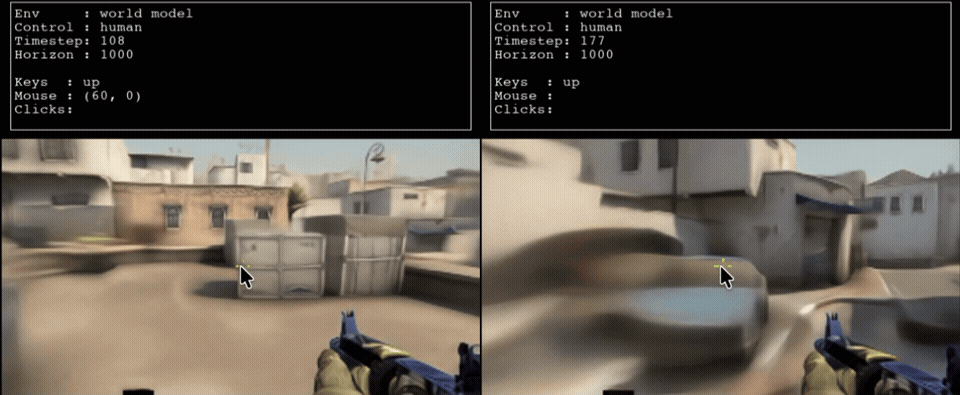
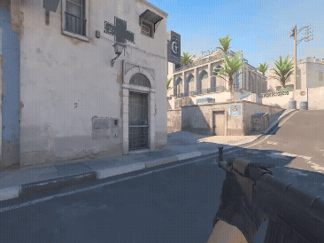

<p align="center">
  
</p>

# kuration-sdk

**Kuration curates large Physical AI datasets into training-ready data for world
models.** Point it at time-series data (telemetry, sensor logs) or video, including
video paired with a synchronized action log. It selects the windows worth training
on and writes them as shards, alongside a config that reproduces the run.

For gameplay video specifically, `kuration.gameplay` ships seven operators.
`join_video` pairs an action log with a video, frame by frame. `pixel_shift`
measures how many pixels the screen moves for every isolated keypress, and
`action_state_consistency` uses those measurements to flag clips where a
keypress didn't produce the on-screen motion it should have. `collision`
detects and classifies wall-hits, so the rare interaction moments a world
model needs to learn physics from can be oversampled instead of averaged out.
`slam_pipeline` recovers a camera's 3D path from raw video; `slam_quality`
scores each window's reconstruction; `slam_motion_diversity` bins windows by
how the camera moved.

```python
from kuration import input

dataset = (
    input("sessions/*.parquet", time="timestamp", entity="device")
    .window(4, stride=2, unit="seconds")
    .measure("activity", "std", of="signal")
    .measure("fault_rate", "rate", of="fault")
    .bin("activity", bins=8)
    .bin("fault_rate", bins=4)
    .split(test=0.1)
    .sample("equal", n=5_000)
    .options(seed=7)
)

print(dataset.explain().render())
dataset.output("out/training-v1")
```

The result is a train/test set of shards plus a `config.json` recording the schema
and pipeline so the same run can be rebuilt. Every shard has a SHA-256 checksum in
the manifest, so resume and verification are safe.

## Contents

- [Install](#install)
- [Try it locally](#try-it-locally)
- [What's in a written dataset](#whats-in-a-written-dataset)
- [Choose your path](#choose-your-path)
- [Examples](#examples)
- [kuration-ai — the companion package](#kuration-ai--the-companion-package)
  - [What's in here](#whats-in-here)
  - [Run any notebook in a browser](#run-any-notebook-in-a-browser)
  - [Getting started](#getting-started)
  - [Use cases](#use-cases)
    - [Motion-diversity coverage](#motion-diversity-coverage)
    - [Rare-event coverage](#rare-event-coverage)
    - [Diversity sampling](#diversity-sampling)
  - [Beyond the gallery](#beyond-the-gallery)
    - [Sampling methods](#sampling-methods)
    - [Data source adapters](#data-source-adapters)
    - [Output formats and presets](#output-formats-and-presets)
    - [Pre-selection filters](#pre-selection-filters)
    - [Fluent pipeline methods](#fluent-pipeline-methods)
  - [Reproducibility](#reproducibility)
  - [Writing your own operation](#writing-your-own-operation)
  - [CLI reference](#cli-reference)
    - [`kai list`](#kai-list)
    - [`kai describe`](#kai-describe)
  - [Coming next](#coming-next)
  - [Reference](#reference)
  - [Contributing](#contributing)
  - [License](#license)
- [Project status](#project-status)
- [Contributing](#contributing-1)

<p align="center">
  
</p>

## Install

The SDK isn't on PyPI yet. See ROADMAP.md for what's left before the first release.
Install from source:

```bash
git clone https://github.com/aintropy-solutions/kuration-sdk.git
cd kuration-sdk
python -m pip install -e .
```

The NumPy-only core handles in-memory, CSV, JSON, and NPZ workflows. Add only the integrations a
pipeline needs:

```bash
python -m pip install -e '.[methods,parquet]'  # selection methods + Parquet
python -m pip install -e '.[video]'            # PyAV video frames
python -m pip install -e '.[stats]'            # Matplotlib stats plots
python -m pip install -e '.[gameplay]'         # all gameplay operators (pixel_shift, action_state_consistency, slam_*, collision)
python -m pip install -e '.[ray]'              # distributed source execution
python -m pip install -e '.[s3]'               # fsspec + the S3 backend
python -m pip install -e '.[all]'              # every runtime integration/backend
```

`pipeline.explain()` reports the extras required by a planned run before it reads the full
dataset. The provider-specific cloud extras are `s3`, `gcs`, and `azure`; `cloud` installs only
the backend-neutral fsspec layer for environments that manage provider packages separately.

`kuration.gameplay` ships seven gameplay operators: `join_video`, `pixel_shift`,
`action_state_consistency`, `slam_pipeline`, `slam_quality`, `slam_motion_diversity`,
and `collision`. Importing the module registers them on the standard `Pipeline`
class, so an ordinary pipeline can call them as methods:

```python
import kuration.gameplay as gameplay

pipeline = (
    gameplay.slam_pipeline("slam-export/manifest.json")
    .window(32, stride=16)
    .slam_motion_diversity()
    .slam_quality(min_score=0.6)
    .options(progress="auto")
)

report = pipeline.stats()                 # rich HTML in Jupyter
report.plot()                             # automatically chooses the gameplay plot
evidence = report.examples(
    metric="slam_quality_score",
    compare="selected-vs-rejected",
)
```

`kuration.gameplay` doesn't create a separate Pipeline class. Importing it adds gameplay
methods (and gameplay-specific stats) to the standard `kuration.Pipeline`, and the core
`stats()` call still works the same way. `report.available()` lists the plots and evidence
modes for that specific report. When the pipeline is running on real video, the evidence
panel shows the actual frames and the action stream around each example. For side-by-side
video review, `gameplay.compare_videos(before, after)` renders synchronized players and can
save the comparison as a standalone HTML file.

<p align="center">
  
  <br>
  <sub><em>DIAMOND's CS:GO world model blurring out on contact with solid objects (car, crates, wall).</em></sub>
</p>

Stateful checks like action-state consistency also return a pipeline, so you keep working
with the same object:

```python
pipeline = pipeline.action_state_consistency(baselines=baselines, controls=["W"])
verdict = pipeline.metadata["gameplay"]["action_state_consistency"]["result"]
```

The pipeline you get back is the same immutable pipeline. You can keep chaining
`.sample()`, `.output()`, or any other operator from it. Use `.analyze(...)` instead if
you just want the analyzer result on its own, without the pipeline.

<p align="center">
  
  <br>
  <sub><em>The clip is flagged by the model as it has two instances where the player collides with the wall.</em></sub>
</p>

## Try it locally

The repository includes a deterministic, download-free sensor example using only NumPy:

```bash
git clone https://github.com/aintropy-solutions/kuration-sdk.git
cd kuration-sdk
python -m pip install .
python examples/quickstart.py --out quickstart-out
kur-inspect quickstart-out --verify
```

The example generates six in-memory sensor sessions and scores 42 windows. It picks the 12
that cover the widest range of activity and fault patterns, writes them as train/test NPZ
shards, and reads one back to confirm the output is valid. Follow the
**[guided quickstart](https://aintropy-solutions.github.io/kuration-sdk/quickstart/)** for the
operator-by-operator explanation.

## What's in a written dataset

```text
out/training-v1/
├── config.json                 # resolved job, pipeline, versions, and provenance
├── dataset_manifest.json       # shard index, splits, shapes, sizes, and SHA-256
├── dataset.commit.json         # final publication state and metadata checksums
├── train/
│   └── <source>_<entity>_<hash>_shard0000.npz
└── test/
    └── <source>_<entity>_<hash>_shard0000.npz
```

```bash
kur-inspect out/training-v1 --verify
kur-stats out/training-v1 --html stats.html
kur-diff out/training-v0 out/training-v1
kur-check out/training-v1 --policy quality.json
kur-export out/training-v1 --out arrays/ --format parquet
```

If you don't have a job spec yet, you can infer a schema, scaffold a job, and inspect the
data before running anything:

```bash
kur-infer   telemetry.csv --out schema.json
kur-init    telemetry.csv --out job.json --dataset-out out/training-v1
kur-preview job.json
kur-curate  job.json --review
```

Every command is also a `kur` subcommand (`kur curate job.json`); `kur --help` lists them and
`kur completion zsh` prints a completion script.

If you already have a dataset in a supported format, you can import it directly. The adapter
is auto-detected and no strategy or selection is needed:

```bash
kur-import gameplay.npz --out out/gameplay
kur-import telemetry.csv --out out/telemetry
kur-inspect out/gameplay --verify
```

Selection is deterministic regardless of worker count or executor. `resume=True` reuses
a shard only when both its byte size and SHA-256 checksum still match. Jobs, artifact
formats, and installed components carry version identifiers, and incompatible combinations
raise clear errors instead of proceeding silently. Every optional integration stays
outside the NumPy-only core.

## Choose your path

| I want to… | Start here |
|---|---|
| Build my first curated dataset | [Quickstart](https://aintropy-solutions.github.io/kuration-sdk/quickstart/) |
| Understand the product and its data model | [Core concepts](https://aintropy-solutions.github.io/kuration-sdk/overview/) |
| Find the right pipeline operation | [Fluent pipeline guide](https://aintropy-solutions.github.io/kuration-sdk/pipeline/) |
| Solve a task such as streaming, cloud output, or comparison | [Recipe cookbook](https://aintropy-solutions.github.io/kuration-sdk/usage/) |
| Integrate a data format | [Adapters](https://aintropy-solutions.github.io/kuration-sdk/adapters/) |
| Build a reusable operator or transform | [Operators](https://aintropy-solutions.github.io/kuration-sdk/operators/) |
| Run checked JSON jobs and CLIs | [Job and CLI reference](https://aintropy-solutions.github.io/kuration-sdk/jobs/) |
| Operate or audit generated artifacts | [Output and integrity](https://aintropy-solutions.github.io/kuration-sdk/output/) |
| Look up an exact Python signature | [API reference](https://aintropy-solutions.github.io/kuration-sdk/api/) |
| Understand internals and extension boundaries | [Architecture](https://aintropy-solutions.github.io/kuration-sdk/architecture/) |

The **[documentation home](https://aintropy-solutions.github.io/kuration-sdk/)** groups the complete documentation by getting
started, guides, extensions, operations, and reference.

## Examples

| Example | What it does |
|---|---|
| [`quickstart.py`](https://github.com/aintropy-solutions/kuration-sdk/blob/main/examples/quickstart.py) | Runs the ten-minute quick start: builds six in-memory sensor sessions, selects 12 diverse windows, writes NumPy shards, reads one back. |
| [`02_robotics_action_aware.py`](https://github.com/aintropy-solutions/kuration-sdk/blob/main/examples/02_robotics_action_aware.py) | Robotics: combines a learned action-informativeness score with geometric end-effector-speed coverage, plus coverage across motion phases. Needs the `[methods]` extra. |
| [`05_custom_operators.py`](https://github.com/aintropy-solutions/kuration-sdk/blob/main/examples/05_custom_operators.py) | Shows two ways to write your own operator: compositional (a function that chains existing operators) and transform-backed (custom batch code that produces a new feature). |
| [`06_gameplay_operator_methods.py`](https://github.com/aintropy-solutions/kuration-sdk/blob/main/examples/06_gameplay_operator_methods.py) | Uses the gameplay SLAM trajectory operators on synthetic precomputed camera trajectories. NumPy core only — no video decoder or GPU needed. |
| [`07_action_state_consistency.py`](https://github.com/aintropy-solutions/kuration-sdk/blob/main/examples/07_action_state_consistency.py) | Runs `.action_state_consistency(...)` on a synthetic clip via an in-memory fake video provider. Shows the verdict (consistent / inconsistent / inconclusive) attached to the pipeline metadata. |
| [`gameplay_stats.ipynb`](https://github.com/aintropy-solutions/kuration-sdk/blob/main/examples/notebooks/gameplay_stats.ipynb) | JupyterLab notebook: runs `slam_motion_diversity` and `slam_quality` on synthetic camera trajectories, shows candidate stats, plots, and selected-vs-rejected evidence. Optional gameplay-video comparison at the end. |
| [`slam_kurious.ipynb`](https://github.com/aintropy-solutions/kuration-sdk/blob/main/examples/notebooks/slam_kurious.ipynb) | JupyterLab notebook demonstrating the SLAM operators end-to-end: reconstructs a trajectory from raw video, then curates windows by quality and motion diversity. |
| [TeaPearce Counter-Strike](https://github.com/aintropy-solutions/kuration-sdk/blob/main/examples/public_data/teapearce_csgo.md) | Curates human Counter-Strike gameplay for behavioral-cloning or world-model training. Reads the public TeaPearce HDF5 dataset, covers keyboard/mouse activity, reserves budget for rare kill/death events. |
| [Open P2P](https://github.com/aintropy-solutions/kuration-sdk/blob/main/examples/public_data/open_p2p.md) | Curates Elefant AI's Open P2P dataset across games, action patterns, corrections, and text instructions. Reads Protobuf annotations without decoding video. |

## kuration-ai — the companion package


### What's in here

- **[`kuration-ai/notebooks/`](./kuration-ai/notebooks/)**. One-click Binder and Colab launchers. The first cell in each notebook installs the SDK.
- **The `kuration-ai` companion package**: source at [`kuration-ai/src/kuration_ai/`](./kuration-ai/src/kuration_ai/), examples at [`kuration-ai/examples/`](./kuration-ai/examples/), design notes at [`kuration-ai/design/`](./kuration-ai/design/), tests at [`kuration-ai/tests/`](./kuration-ai/tests/), package config at [`kuration-ai/pyproject.toml`](./kuration-ai/pyproject.toml), release notes at [`kuration-ai/CHANGELOG.md`](./kuration-ai/CHANGELOG.md). `kai` CLI plus three shipped operations (`BalancedSelector`, `DiverseSubset`, `RareEventCoverage`). Mirrored from `kuration-ai/python-sdk`.

Long-form blog posts on physical-AI data curation live on [aintropy.ai/blog](https://aintropy.ai/blog), published directly from Drive through the content pipeline.

### Run any notebook in a browser

Every notebook has a Colab and a Binder badge. Click, wait, run.

> **Launcher status.** The URLs below point at `aintropy-solutions/kuration-sdk`. Colab and Binder can only clone public repositories, so the badges activate once this repo goes public. In the meantime, clone and run each notebook locally. See the notebook's own README for the exact install command (the `[gameplay]` extra is only needed by `action-state-consistency` and `collision-aware`).

| Notebook | Read | Launch |
|---|---|---|
| `starter` | [README](./kuration-ai/notebooks/starter/) | [](https://colab.research.google.com/github/aintropy-solutions/kuration-sdk/blob/main/kuration-ai/notebooks/starter/starter.ipynb) [](https://mybinder.org/v2/gh/aintropy-solutions/kuration-sdk/HEAD?labpath=kuration-ai%2Fnotebooks%2Fstarter%2Fstarter.ipynb) |
| `action-state-consistency` | [README](./kuration-ai/notebooks/action-state-consistency/) | [](https://colab.research.google.com/github/aintropy-solutions/kuration-sdk/blob/main/kuration-ai/notebooks/action-state-consistency/action-state-consistency.ipynb) [](https://mybinder.org/v2/gh/aintropy-solutions/kuration-sdk/HEAD?labpath=kuration-ai%2Fnotebooks%2Faction-state-consistency%2Faction-state-consistency.ipynb) |
| `collision-aware` | [README](./kuration-ai/notebooks/collision-aware/) | [](https://colab.research.google.com/github/aintropy-solutions/kuration-sdk/blob/main/kuration-ai/notebooks/collision-aware/collision-aware.ipynb) [](https://mybinder.org/v2/gh/aintropy-solutions/kuration-sdk/HEAD?labpath=kuration-ai%2Fnotebooks%2Fcollision-aware%2Fcollision-aware.ipynb) |
| `coverage-based-curation` | [README](./kuration-ai/notebooks/coverage-based-curation/) | [](https://colab.research.google.com/github/aintropy-solutions/kuration-sdk/blob/main/kuration-ai/notebooks/coverage-based-curation/coverage-based-curation.ipynb) [](https://mybinder.org/v2/gh/aintropy-solutions/kuration-sdk/HEAD?labpath=kuration-ai%2Fnotebooks%2Fcoverage-based-curation%2Fcoverage-based-curation.ipynb) |

The notebooks above walk through the Kuration SDK's gameplay operators against Counter-Strike telemetry. The `kuration-ai` companion package that ships alongside is the same shape of tool for the sampling half of world-model curation. It ships three composable operations: `BalancedSelector` for motion-diversity coverage, `RareEventCoverage` for oversampling collisions and other rare events, and `DiverseSubset` for multi-axis diversity sampling. Plus a small pattern for writing your own. Runs from a config file you commit alongside your training code, so a curated subset is re-derivable months later against the same package versions.


[](https://github.com/kuration-ai/python-sdk/actions/workflows/tests.yml)


### Getting started

Install:

```bash
pip install kuration-ai
```

Runs on Python 3.11 or later. Depends on `kuration-sdk[methods,parquet]`.

Your first curated result, in seven lines:

```python
from kuration_ai import input, RareEventCoverage

sessions = {"clip-1": [{"t": float(i), "collision": 1 if i % 30 == 0 else 0} for i in range(200)]}
pipeline = input(sessions, time="t", hz=10.0).window(8, stride=4)
result = (RareEventCoverage(of="collision", count=15, weight=2.0)
          .apply(pipeline).options(seed=1).collect())
print(f"selected {len(result.selected)} windows")
```

Prints `selected 15 windows`. Replace the in-memory `sessions` dict with a folder of CSVs (`input("clips/*.csv", time="t")`), a Parquet dataset, or a Hugging Face dataset. The operation stays identical.

### Use cases

Three curation jobs come with the library. Each has its own runnable example folder with the expected output baked into the folder's README.

#### Motion-diversity coverage

Most gameplay is the same movement: walking forward, standard turns, level ground. Sample naively and the training set inherits that natural distribution and barely touches the harder motions (tight turns, sharp climbs, high-speed segments). Quantile binning matches the distribution, which is exactly what discards rare events. Coverage has to be measured on the axis you actually care about.

`BalancedSelector` measures a per-window metric on one axis (turning, path length, whatever), bins the values evenly across the observed range, then samples the same count from every bin. That's the pattern the SDK's `slam_motion_diversity` uses (default axis `slam_path_length`; the Intro blog example switches to `slam_turn_degrees`), generalized to any per-window column.

Runnable example: [`kuration-ai/examples/motion-coverage/`](./kuration-ai/examples/motion-coverage/)

#### Rare-event coverage

A world model only learns the physics that show up consistently in its training data. And the interactions it most needs to learn (a moving object hitting a solid one, a player-object contact) are the ones good players avoid. That's why DIAMOND's CS:GO world model lets players double- and triple-jump against walls: successive jumps don't appear often enough in real play for the model to learn they shouldn't be possible.

The fix isn't more footage. It's finding the events already in the footage you have and oversampling them past their natural base rate. `RareEventCoverage` measures the rare event's per-window rate, then weights the sampler so those windows show up far more often than they do in the wild.

Runnable example: [`kuration-ai/examples/rare-event-coverage/`](./kuration-ai/examples/rare-event-coverage/)

#### Diversity sampling

Most activity-based metrics move together. A chaotic firefight is high on every axis at once; an idle stretch is low on all of them. Pick a single axis to sample on and you inherit whatever the other axes happen to correlate with. Cluster the windows in a multi-axis feature space and sample equally from each cluster, and the redundant part of the corpus stops crowding out the parts that actually differ from it.

The Intro World-Model-Data-Curation blog names this "diversity sampling", one of the things "collision detection, kinematics, action-state checks, and diversity sampling all get easier on a dataset that previously had no notion of space." `DiverseSubset` clusters over any set of pre-measured features and takes an equal share from every cluster. Optional dedup pre-pass filters near-duplicates first.

Runnable example: [`kuration-ai/examples/diversity-sampling/`](./kuration-ai/examples/diversity-sampling/)

Each folder holds one runnable script, a README with the exact expected output, and a "what to try next" section for parameter adjustments.

### Beyond the gallery

The three shipped operations are curated shortcuts. Kuration AI sits on top of a broader pipeline library with 45 registered components, and you can drop into the raw fluent API for anything the gallery doesn't cover.

#### Sampling methods

Eleven methods, invoked via `.sample("name", ...)`.

- Coverage: `equal` / `uniform-bins`, `cluster-balanced`, `k-center`, `facility-location`
- Weighting and ranking: `weighted`, `top-k`, `target-distribution`, `dsir`
- Rarity: `rare` (density-inverse), `typical` (prototype-favoring)
- Predicate-only: `filter`

#### Data source adapters

Eleven registered adapters, invoked via `input(...)`:

- `timeseries`: CSV files, in-memory dict of rows, list of dicts
- `parquet-dataset`, `jsonl`, `hdf5`, `npz`, `zarr`: file-based formats
- `huggingface`: Hugging Face datasets
- `curated`: re-curate a previously-curated Kuration dataset
- `aintropy/slam-trajectory`, `aintropy/collision-asg`, `aintropy/collision-teapearce`: gameplay-specific

#### Output formats and presets

Seven total: `numpy-timeseries`, `pytorch-sequences`, `tabular` (flat Parquet), plus four raw shard containers (`npz`, `json`, `parquet`, `hdf5`).

#### Pre-selection filters

Two: `anomaly` (Isolation Forest), `dedup` (SemDeDup).

#### Fluent pipeline methods

Core methods used by the shipped operations: `.window()`, `.measure()`, `.filter()`, `.bin()`, `.sample()`, `.split()`, `.output()`, `.options()`, `.describe()`, `.collect()`. Pipeline exposes additional methods for tagging, scoring, video joins, previewing, and lifecycle stats.

Full inventory with parameters, extras, and runtime dependencies at [`kuration-ai/docs/history/sdk_operation_inventory.md`](./kuration-ai/docs/history/sdk_operation_inventory.md).

Every gallery operation is transparent about the primitives it calls. Run `.describe()` on the resulting pipeline and you see the exact chain. Drop the `kuration_ai` imports and your custom pipelines still work. No lock-in.

### Reproducibility

Every run of Kuration AI is deterministic. Commit a config file alongside your training code, and a teammate re-running it against the same package versions a year from now produces the same curated dataset.

Same operation, three equivalent invocation styles. The three are guaranteed to produce identical results, enforced by test.

```python
# 1. Direct: one operation, one line
result = BalancedSelector(feature="motion", of="turn_rate").apply(pipeline).collect()

# 2. Chained instances: pipeline in code
result = run(pipeline, [
    RareEventCoverage(of="collision"),
    BalancedSelector(feature="motion", of="turn_rate"),
]).collect()

# 3. Config dict: pipeline in YAML, JSON, or TOML
config = [
    {"type": "RareEventCoverage", "of": "collision"},
    {"type": "BalancedSelector", "feature": "motion", "of": "turn_rate"},
]
result = run(pipeline, config).collect()
```

The config-dict form is the artifact you commit. Same package versions plus the same `curate.yaml` produce the same curated dataset.

### Writing your own operation

Any Python class with `.apply(pipeline) -> pipeline` is a valid operation. No inheritance, no registration required. Six lines for a domain-specific example:

```python
from dataclasses import dataclass
from kuration_ai import run, BalancedSelector

@dataclass(frozen=True)
class OnlyActiveWindows:
    threshold: float = 0.1

    def apply(self, pipeline):
        return (pipeline
                .measure("turn_activity", "std", of="turn_rate")
                .filter("turn_activity", ">", self.threshold))

# Compose it with the shipped operations
result = run(pipeline, [
    OnlyActiveWindows(threshold=0.15),
    BalancedSelector(feature="motion", of="turn_rate", bins=4, count=20),
]).options(seed=1).collect()
```

Register it to also drive it from a config dict:

```python
from kuration_ai import register
register("OnlyActiveWindows", OnlyActiveWindows)
```

For the full extension contract, see [`kuration-ai/design/04_extension_seam.md`](./kuration-ai/design/04_extension_seam.md).

### CLI reference

The `kai` command is installed alongside the library.

#### `kai list`

```bash
kai list
```

Lists available operations (built-in plus any you have registered), annotated with which extras each one needs at runtime.

#### `kai describe`

```bash
kai describe BalancedSelector
```

Shows one operation's docstring and parameter contract.

### Coming next

Not in the initial release, on the roadmap:

- **Gameplay operators**: SLAM motion diversity, SLAM quality, pixel-shift, action-state consistency, and collision detection (both regular and directional variants) for game and video telemetry. The notebook set above previews some of these.
- **`kai init <profile>`**: project scaffolder for new users starting from scratch.
- **Property-based test suite**: the initial release ships with a 52-test smoke suite; property-based tests follow.

### Reference

- [`kuration-ai/design/`](./kuration-ai/design/): five design decisions behind the API (operation abstraction, composition, config model, extension seam, workarounds).
- [`kuration-ai/CHANGELOG.md`](./kuration-ai/CHANGELOG.md): release notes for `kuration-ai`.
- [`kuration-ai/MIGRATION_NOTE.md`](./kuration-ai/MIGRATION_NOTE.md): where this content came from and why.
- [Issue tracker](https://github.com/kuration-ai/python-sdk/issues) for feature requests, bug reports, roadmap discussion.
- [`kuration-ai/examples/`](./kuration-ai/examples/): the gallery of runnable use cases.

### Contributing

Two contributing scopes coexist in this repo:

- [`CONTRIBUTING.md`](./CONTRIBUTING.md) at the repo root: for the `kuration-sdk` repo as a whole (the pipeline primitive and its docs, examples, plugins, and CI).
- [`kuration-ai/CONTRIBUTING.md`](./kuration-ai/CONTRIBUTING.md): for the `kuration-ai` companion package specifically (dev install, tests, adding operations).

### License

[Apache 2.0](./LICENSE).

## Project status

Kuration currently targets Python 3.11 through 3.14. Optional integrations are tested at
both their declared minimum versions and their current releases. CI runs over 1,200 test
functions across 96 test files, including property-based invariants, wheel installation,
every CLI entry point, and integration paths for Zarr, PyTorch, Hugging Face, PyAV, and Ray.

The SDK is a `0.x` beta. The supported surface and deprecation rules are documented in the
**[compatibility policy](https://aintropy-solutions.github.io/kuration-sdk/compatibility/)**. See
[SECURITY.md](https://github.com/aintropy-solutions/kuration-sdk/blob/main/SECURITY.md) for private
reporting and runtime trust boundaries,
[CHANGELOG.md](https://github.com/aintropy-solutions/kuration-sdk/blob/main/CHANGELOG.md) for notable
changes, and [ROADMAP.md](https://github.com/aintropy-solutions/kuration-sdk/blob/main/ROADMAP.md) for the
remaining public-release gates.

## Contributing

Contributions to the core SDK or the maintained gameplay module should follow
[CONTRIBUTING.md](https://github.com/aintropy-solutions/kuration-sdk/blob/main/CONTRIBUTING.md).
The gameplay operators ship inside this repo. If you want to publish an independent
extension, start from the plugin template in
[`plugins/`](https://github.com/aintropy-solutions/kuration-sdk/tree/main/plugins).

```bash
python -m pip install -e '.[dev,methods,parquet,array,s3,gcs,azure,p2p]'
python -m pytest tests/ -q
python -m ruff check src tests examples
python -m mypy
```

Validate one repository plugin in the same isolated environment used by CI:

```bash
python scripts/check_plugin.py plugins/<plugin-name>
```

Read [CONTRIBUTING.md](https://github.com/aintropy-solutions/kuration-sdk/blob/main/CONTRIBUTING.md)
before proposing a component or public contract change.
