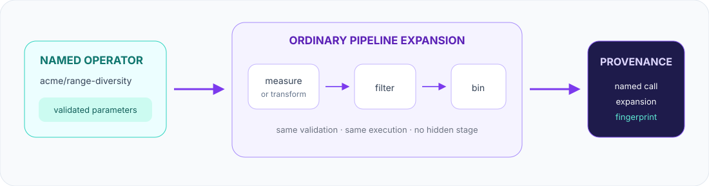

# Building operators

An operator is a named, validated recipe that expands into ordinary pipeline operations.
It is the right abstraction for a curation decision your team wants to review once and reuse
across datasets or projects.

<p align="center">
  
</p>

Operators do not introduce a hidden execution system. Their expansion is validated using the
same schema and strategy rules as handwritten pipeline code, and both the named call and expanded
operations are recorded in artifact provenance.

## Programming model

There is one `Pipeline` type. An operator registration adds a method to that type; it does
not create a domain-specific pipeline or require string dispatch:

```python
from kuration import Pipeline, input
import acme_kuration  # imports a module that calls register_operator(...)

base = input("sessions/*.parquet", time="t").window(64, stride=32)
pipeline = base.signal_diversity(field="motor_current", bins=6)

assert type(base) is Pipeline
assert type(pipeline) is Pipeline
```

The method is resolved from the registered component name:

| registered name | normal Python spelling | always-available qualified spelling |
|---|---|---|
| `acme/signal-diversity` | `.signal_diversity(...)` | `.acme__signal_diversity(...)` |
| `aintropy/pixel-shift` | `.pixel_shift(...)` | `.aintropy__pixel_shift(...)` |
| `aintropy/action-state-consistency` | `.action_state_consistency(...)` | `.aintropy__action_state_consistency(...)` |

Hyphens and dots become underscores in the readable spelling. If two namespaces expose the same
local name, the short spelling fails with the qualified alternatives instead of choosing one (an
un-namespaced operator whose name *is* the short spelling keeps it, and the namespaced ones stay
callable under their qualified aliases). The qualified form is also useful in shared libraries
that want to make component ownership explicit.

A local name that is already a `Pipeline` attribute — `report`, `window`, `filter`, `output`,
`schema`, … — is **rejected at registration** (and by `kur-plugin-check`): Python resolves the
real attribute before the generated method, so such an operator would be silently shadowed.
Rename it (`acme/report-balance`).

Import order is flexible for the process-wide registry: importing a registration module makes
its methods available even on an existing default-registry pipeline. A pipeline created with an
explicit registry remains isolated and resolves operators only through that registry snapshot.
`Pipeline.apply(name, **params)` remains a compatibility path for integrations that receive a
component name as data; ordinary Python code should use the generated method.

## 1. Package an ordinary pipeline recipe

This operator measures variability and adds it as a diversity axis:

```python
from kuration import register_operator

SIGNAL_PARAMETERS = {
    "type": "object",
    "properties": {
        "field": {"type": "string"},
        "bins": {"type": "integer", "minimum": 2},
    },
    "required": ["field"],
    "additionalProperties": False,
}

@register_operator(
    "acme/signal-diversity",
    description="Balance selected windows by signal variability",
    parameters=SIGNAL_PARAMETERS,
    version="1",
)
def signal_diversity(pipeline, *, field, bins=8):
    return (pipeline
            .measure("signal_variability", "std", of=field)
            .bin("signal_variability", bins=bins))
```

Use it like a built-in operation:

```python
pipeline = (
    input("sessions/*.parquet", time="t")
    .window(64, stride=32)
    .signal_diversity(field="motor_current", bins=6)
    .sample("equal", n=10_000)
)
```

Unknown parameters, missing `field`, invalid bin counts, unknown fields, and feature-name
collisions all fail when the pipeline is built—not halfway through a long run.

## 2. Wrap bounded window computation

The closed metric DSL should remain the first choice for ordinary reductions. Use a batch
transform when computation needs custom NumPy/model code, multiple fields, or decoded media.

```python
import numpy as np

from kuration import register_batch_transform, register_operator

@register_batch_transform(
    "acme/window-range",
    outputs=("window_range",),
    inputs=("field:signal",),
    resources={"preferred_batch_size": 64},
)
class WindowRange:
    def transform_batch(self, batch, ctx):
        # ctx.input_token() resolves a per-use remap; hardcoding "field:signal" here would
        # break the moment a caller passes a different field (see below).
        values = np.asarray(batch[ctx.input_token("field:signal")], dtype=np.float64)
        valid_steps = batch["valid_steps"]  # each row's real length; the rest is NaN padding
        ranges = np.empty(values.shape[0], dtype=np.float64)
        for i, steps in enumerate(valid_steps):
            ranges[i] = np.ptp(values[i, :steps])
        return {"window_range": ranges}

@register_operator(
    "acme/range-diversity",
    description="Compute a custom window range and balance by it",
    parameters=SIGNAL_PARAMETERS,
    version="1",
)
def range_diversity(pipeline, *, field, bins=8):
    return (pipeline
            .transform("acme/window-range", inputs=[f"field:{field}"])
            .bin("window_range", bins=bins))
```

The transform receives bounded batches. It must return one finite scalar per segment for every
declared output. Imports for heavyweight frameworks belong inside the implementation path, so
component discovery and ordinary core imports remain dependency-light.

For edge-sensitive events, registration accepts `lookbehind=<ticks>`, `lookahead=<ticks>`, and
`ownership="rightmost-start"`. Read the typed context with `ctx.before("field:signal")` and
`ctx.after("field:signal")`; source-edge entries are `None`. Immutable `ctx.owned_lengths` gives
the prefix of each logical window whose event starts belong to that segment. The corresponding
rc2 batch keys remain available during the release-candidate compatibility window. Either count
may instead be a `{declared input token: count}` mapping (`lookbehind={"field:signal": 1}`) when
only one input needs boundary context — the runner then extracts, and for media decodes, nothing
for the others.

A caller may remap the declared inputs per use (`.transform(name, inputs=["media:shot",
"field:signal"])`), supplying one same-kind token per declared role. Address the batch through
`ctx.input_token("media:frame")` (or the `ctx.inputs` role→token mapping) so a remapped use works;
a hardcoded registration token would pass construction and fail mid-run. `field:` batches are
`(B,T,E,D)` and NaN-padded to the batch's widest extent, so use `ctx.valid_steps` (also
`batch["valid_steps"]`) to bound each row to its real timesteps.

For video, declare `inputs=("media:frame",)` and a semantic requirement such as
`media_requirements={"kind": "video-frame", "layout": "HWC", "color_space": "RGB"}`.
Kuration validates the media contract before decoding frames.

## 3. Test the contract

Test the operator at three levels:

```python
def test_signal_operator_expands_and_selects():
    base = input([{"signal": float(i)} for i in range(16)]).window(4)
    pipeline = base.signal_diversity(field="signal", bins=3)

    description = pipeline.describe()
    assert "signal_variability" in description["strategy"]["define"]
    assert description["strategy"]["binning"]["axes"] == [
        {"metric": "signal_variability", "bins": 3}
    ]

    result = pipeline.sample("equal", n=2).collect()
    assert len(result.selected) == 2
```

Also cover:

- Parameter-schema failures and unknown fields.
- Exact output names, shape, dtype, and non-finite rejection for transforms.
- Discovery metadata through `kur-list` and `kur-describe`.
- Clean installed-package discovery—not only imports from a checkout.
- Provenance in a written `config.json`.
- Optional dependency absence with an actionable installation message.

## 4. Discover and inspect

The same components are discoverable from the CLI (see
[Command-line interface](#command-line-interface)) or from Python:

Python callers use `list_components("operator")` and
`describe_component("operator", "acme/signal-diversity")`. Descriptors include parameter
schemas, dependency hints, capabilities, package and module identity, stability metadata, and a
code fingerprint.

Registration also creates the import flow. Import a custom registration module, or let
Kuration discover an installed `kuration.plugins` entry point, then call the operator by its
normalized local name:

```python
import acme_kuration

pipeline = pipeline.signal_diversity(field="signal")
```

`acme/signal-diversity` maps to `signal_diversity`; the always-available qualified spelling is
`acme__signal_diversity`. Ambiguous short names fail with the qualified alternatives instead of
silently choosing one.

**`kur-list`/`kur-describe` run as a separate process** from whatever script imported and
registered your operator. Importing a registration module is enough for *your own* process —
`pipeline.signal_diversity(...)` above works the moment that import runs — but it does nothing
for the CLI's process, which never imports your module at all. For your operator to show up in
`kur-list operators`, it must be discoverable without your script running first: either an
installed `kuration.plugins` entry point (see
[§6 Choose built-in or external packaging](#6-choose-built-in-or-external-packaging)), or a
module path passed to `load_plugins(modules=[...])` if you're calling `list_components`/
`describe_component` from Python yourself rather than through the CLI.

## 5. Built-in operator catalog

Every built-in operator falls into one of three categories, by its primary effect on the
segment pool:

- **Selection** — chooses which windows survive, or their sampling weight (`.sample(...)`/
  `.filter(...)`-driven recipes). A user reaching for "give me N good windows" wants one of
  these.
- **Annotation** — measures or labels windows (adds `Segment.features`/`Segment.records`)
  without deciding which survive; or, for a few built-ins, runs a stateful audit and attaches
  its result to pipeline metadata rather than pretending it is a per-segment feature. Some
  annotation operators optionally filter too (`slam-quality`'s `min_score=`) — that's still
  annotation-primary, since the filter is a secondary, opt-in step on top of the measurement.
- **Aggregation** — reduces a per-window feature up to a per-group (e.g. per-source) rollup.
  **No built-in operator does this yet.** It surfaced as a real, confirmed gap while rehosting
  `action_state_consistency` as a per-window `SegmentScorer` (see
  [action-state-consistency.md](action-state-consistency.md)): reconstructing that scorer's old
  per-clip verdict from its new per-window score needs a group-by-source-then-reduce operator
  that doesn't exist in the SDK today. Building one is future work, not something force-fit into
  an existing operator to make this table look complete.

Importing `kuration.gameplay` registers every maintained gameplay operator on the ordinary core
pipeline. Importing the domain remains dependency-light; optional frameworks load only when an
operator's execution path needs them.

| registered operator | category | method | expands to | execution dependency |
|---|---|---|---|---|
| `aintropy/pixel-shift` | Annotation | `.pixel_shift(controls=None, boundary="exclude")` | the bounded transform of the same name | OpenCV via `[pixel-shift]` |
| `aintropy/action-state-consistency` | Annotation | `.action_state_consistency(baselines=..., controls=None, ...)` | dataset-mode-only: the analyzer of the same name plus pipeline metadata attachment. For a live pipeline, `.score("aintropy/action-state-consistency", out=..., baselines=..., controls=...)` reads pixel-shift's own `Segment.records` instead | OpenCV via `[action-state]` |
| `aintropy/collision` | Annotation | `.collision(map_for_source=..., map_registry=..., dist_path=..., **thresholds)` | the bounded transform of the same name | trimesh/rtree via `[collision]` |
| `aintropy/collision-directional` | Annotation | `.collision_directional(map_registry=..., ramp_models_path=..., ...)` | the tick-stream analyzer of the same name plus pipeline metadata attachment | trimesh/rtree via `[collision]` |
| `aintropy/slam-motion-diversity` | Annotation | `.slam_motion_diversity(axis="slam_path_length", bins=8)` | `aintropy/slam-motion` plus a bin axis | NumPy for a precomputed trajectory |
| `aintropy/slam-quality` | Annotation | `.slam_quality(min_score=None, **quality_options)` | `aintropy/slam-quality` plus an optional predicate | NumPy for a precomputed trajectory |

```python
import kuration.gameplay  # registers the methods
from kuration import input

pipeline = (
    input("telemetry/*.parquet", time="timestamp")
    .join_video(lambda source: source.replace(".parquet", ".mp4"), tolerance=0.020)
    .window(32, stride=16)
    .pixel_shift(controls=["W", "S", "A", "D"])
    .bin("w_shift_mean", bins=8)
    .sample("equal", n=2_000)
)
```

Pixel Shift and action-state consistency need DIAMOND-compatible action rows and aligned video
frames. Action-state remains stateful internally: its direct operator explicitly drives the
registered analyzer once and attaches the verdict rather than pretending it is a segment
feature. The SLAM operators expect the trajectory schema produced by
`gameplay.slam_reconstruct(...)` or `gameplay.input_slam(...)`. The collision operators expect
canonical position/angle/button telemetry plus map geometry files. See
[Pixel Shift](pixel-shift.md), [Action-state consistency](action-state-consistency.md),
[Collision detection](collision.md), and [SLAM](slam.md) for those input contracts.

The ordinary core operations—`.window()`, `.measure()`, `.transform()`, `.filter()`, `.bin()`,
`.score()`, `.tag()`, `.sample()`, and the rest—are listed with exact signatures in the
[Pipeline operator reference](pipeline.md#operator-reference). At runtime,
`list_components("operator")` is the authoritative catalog for the currently installed and
imported environment (the CLI has an equivalent — see
[Command-line interface](#command-line-interface)).

Importing `kuration.selection` registers three general-purpose curation recipes on the ordinary
core pipeline — no gameplay/video assumptions, no heavy runtime dependency except
`diverse-subset`'s scikit-learn requirement.

| registered operator | category | method | expands to | execution dependency |
|---|---|---|---|---|
| `kuration/balanced-selector` | Selection | `.balanced_selector(feature, of, kind="std", bins=8, count=100)` | `.measure(...).bin(...).sample("equal", ...)` | none (NumPy core) |
| `kuration/rare-event-coverage` | Selection | `.rare_event_coverage(of, feature="event_rate", count=100, weight=1.0)` | `.measure(..., "rate", ...).sample("weighted", ...)` | none (NumPy core) |
| `kuration/diverse-subset` | Selection | `.diverse_subset(features, count=100, n_clusters=32, dedup_threshold=None)` | optional `.filter("dedup", ...)` then `.sample("cluster-balanced", ...)` | scikit-learn via `[methods]` |

Each is also available as a standalone, configurable dataclass
(`kuration.selection.BalancedSelector`, `RareEventCoverage`, `DiverseSubset`) for direct use, or
as a `{"type": "BalancedSelector", ...}`-style config-dict entry driven through
`kuration.selection.run(pipeline, operations)` /
`kuration.selection.plan(operations)` / `kuration.selection.describe(operations)`. All three
call styles — operator method, direct dataclass, config dict — are guaranteed to produce identical
results; extend the config-dict vocabulary with your own `.apply(pipeline) -> pipeline` class via
`kuration.selection.register_operation_type("MyRecipe", MyRecipeClass)`.

Core itself registers every built-in selection method, pre-selection filter, and whole-pool
scorer as a named operator too — no separate import needed, these are always available. Each
wraps the exact same `.curate()`/`.filter()`/`.score()` call the string-keyed form uses (see
[strategies.md](strategies.md)), so both spellings produce identical results by construction.

| registered operator | category | method | expands to | execution dependency |
|---|---|---|---|---|
| `top-k` | Selection | `.top_k(weights, normalize=None, n=None, hours=None, ...)` | `.curate("top-k", weights=..., ...)` | none (NumPy core) |
| `weighted` | Selection | `.weighted(weights, normalize=None, n=None, hours=None, ...)` | `.curate("weighted", weights=..., ...)` | none (NumPy core) |
| `uniform-bins` | Selection | `.uniform_bins(n=None, hours=None, ...)` | `.curate("uniform-bins", ...)`; needs `.bin(...)` axes declared first | none (NumPy core) |
| `target-distribution` | Selection | `.target_distribution(target=None, n=None, hours=None, ...)` | `.curate("target-distribution", target=..., ...)`; needs `.bin(...)` axes declared first | none (NumPy core) |
| `cluster-balanced` / `k-center` / `facility-location` | Selection | `.cluster_balanced(feature_space, clusters=None, ...)` (same shape for the other two) | `.curate(<name>, feature_space=..., ...)` | scikit-learn via `[methods]` |
| `dsir` | Selection | `.dsir(feature_space, dsir_bins=None, target=None, ...)` | `.curate("dsir", feature_space=..., ...)` | none (NumPy core) |
| `rare` / `typical` | Selection | `.rare(feature_space, knn_k=None, rare_sample=None, ...)` (same shape for `typical`) | `.curate(<name>, feature_space=..., ...)` | scikit-learn via `[methods]` |
| `anomaly` | Annotation | `.anomaly(contamination=None, normalize=None)` | `.filter("anomaly", ...)` | scikit-learn via `[methods]` |
| `dedup` | Annotation | `.dedup(feature_space, threshold=None, n_clusters=None, normalize=None)` | `.filter("dedup", ...)` | scikit-learn via `[methods]` |
| `action-residual` | Annotation | `.action_residual(obs, action, k=None, out="action_residual")` | `.score("action_residual", out=..., ...)` | scikit-learn via `[methods]` |

`cluster-balanced`/`k-center`/`facility-location`/`dsir`/`rare`/`typical` translate a few
kwargs before forwarding to `.curate()`'s `**method_params` (`clusters`→`n_clusters`,
`feature_normalize`→`normalize`, `dsir_bins`→`n_bins`, `knn_k`→`k`, `rare_sample`→`sample`) —
see [`docs/operator-inventory.md`](operator-inventory.md#operators) for the full parameter
tables and why the translation exists.

## 6. Choose built-in or external packaging

First-party gameplay operators accepted into the SDK live under `src/kuration/gameplay/`, register
when that domain is imported or discovered, and declare optional framework requirements through
SDK extras. For an independently versioned or external plugin, publish your own package with this
layout:

```text
acme-kuration/
├── pyproject.toml
├── src/acme_kuration/__init__.py
├── src/acme_kuration/operators.py
└── tests/test_operators.py
```

Expose a registration module through the `kuration.plugins` entry-point group:

```toml
[project.entry-points."kuration.plugins"]
acme = "acme_kuration.operators"
```

Registration happens when kuration loads installed plugins. Use namespaced names (`acme/...`) to
avoid collisions. Keep dataset-specific assumptions visible in the descriptor, README, parameter
schema, and tests. The [customization guide](customization.md) covers registry overlays and the
other extension types.

Once your package is installed, validate its descriptors and discovery transactionally (see
[Command-line interface](#command-line-interface)).

## Complete runnable examples

`examples/05_custom_operators.py` registers both styles,
discovers their descriptors, runs them over small in-memory sessions, and verifies their selected
features. It requires only the NumPy core:

```bash
python examples/05_custom_operators.py
```

```python
--8<-- "examples/05_custom_operators.py"
```

`examples/06_gameplay_operator_methods.py`
uses a synthetic precomputed camera trajectory to demonstrate the maintained gameplay methods,
the namespace-qualified spelling, and the fact that every call returns the same core `Pipeline`:

```bash
python examples/06_gameplay_operator_methods.py
```

```python
--8<-- "examples/06_gameplay_operator_methods.py"
```

## Command-line interface

Discover and inspect any registered operator or transform:

```bash
kur-list operators
kur-describe operator acme/signal-diversity --json
kur-describe transform acme/window-range --json
```

Validate a plugin package's descriptors and discovery after installing it: `kur-plugin-check
acme --json` checks its descriptors and discovery transactionally.
