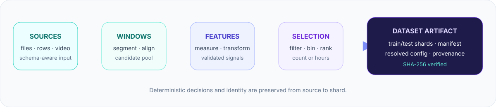

# Core concepts

Kuration is a dataset curation system for sequential data. It sits between raw collection and
training: it decides which windows should enter a dataset, preserves why they were chosen, and
writes the arrays a training loop consumes.

Start with the [guided quickstart](quickstart.md) if you want to run a pipeline now. This page
builds the mental model and then shows the explicit API used for custom schemas, adapters,
strategies, and output contracts.

## The product model

<p align="center">
  
</p>

Five concepts carry through every pipeline, Python API call, and JSON job:

1. **Source** — one leakage boundary such as a session, trajectory, recording, or clip. An
   adapter presents every source as canonical timestamped ticks.
2. **Candidate window** — a fixed-width view over a source. Windows can overlap and are the unit
   measured and selected by count-based pipelines.
3. **Feature** — a finite scalar describing a window. Features come from the closed metric DSL,
   scorers, or bounded batch transforms over fields and media.
4. **Selection** — predicates remove invalid candidates; bins, tags, weights, and methods decide
   what best satisfies the dataset goal. Source/group splits prevent leakage.
5. **Dataset artifact** — encoded train/test shards plus a manifest and resolved configuration.
   The artifact records identity, selection context, provenance, budgets, and integrity metadata.

The candidate pool is not the output dataset. `preview()` inspects raw source quality,
`review()` compares candidates with a proposed count selection, and `inspect`/`diff`/`check`
operate on written artifacts. This separation lets a team answer three different questions:

| Question | Tool |
|---|---|
| Is the source data usable? | `pipeline.preview()` |
| Did selection change the distribution as intended? | `pipeline.review()` |
| Is the delivered artifact intact and acceptable? | `inspect_dataset()`, `compare_datasets()`, `evaluate_quality()` |

Each of those three also has a `kur-*` CLI counterpart (`kur-inspect`, `kur-diff`, `kur-check`) for
scripting and CI — see the [job and CLI reference](jobs.md).

## Two selection outcomes

- **Count selection** chooses up to `n` windows and returns a `CurateResult`; it is ideal while
  designing and reviewing selection behavior.
- **Duration selection** admits the best spans until separate training and test hour budgets are
  filled, then writes the dataset artifact. It is the production path when emitted training
  volume is the real constraint.

The `Pipeline` is the default authoring interface. The explicit `curate(...)` and
`write_dataset(...)` functions expose the same engine for declarative jobs and custom low-level
components. Input-backed enrichments also return a pipeline and retain their namespaced result
in `pipeline.metadata`; inspectors and terminals return detached results only when that result is
the purpose of the call.

## Install only what the plan needs

```bash
pip install kuration-sdk                     # core (numpy only)
pip install "kuration-sdk[methods]"          # + scikit-learn selection/filter methods
pip install "kuration-sdk[parquet,array]"    # + pyarrow / h5py containers and adapters
pip install "kuration-sdk[s3]"               # + fsspec and the S3 provider backend
pip install "kuration-sdk[video,ray]"        # + PyAV media / ordered Ray source backend
```

The NumPy-only core handles ordinary in-memory, CSV, and JSON workflows. Optional dependencies
are lazy and loud: preflight names the missing extra instead of silently changing behavior.
Provider-specific cloud installs are `[s3]`, `[gcs]`, and `[azure]`; `[cloud]` is the
backend-neutral fsspec layer for managed environments that provide a backend separately.

## Explicit end-to-end example

Curating drone-flight logs (CSV) into 64-step position/attitude shards, preferring dynamic,
high-turn-rate windows:

```python
from kuration import (SchemaSpec, TimeseriesAdapter, Segmenter,
                      load_strategy, OutputSpec, write_dataset)

# 1. Declare the dataset's observable vocabulary (data, not code).
schema = SchemaSpec.from_dict({
    "name": "drones", "entity_axis": "drone", "sample_hz": 20.0,
    "fields": {
        "pos": {"kind": "vector", "dims": ["x", "y", "z"],
                "semantics": "position", "max_rate": 50},      # speed-clamp = 50 units/s
        "att": {"kind": "vector", "dims": ["roll", "pitch", "yaw"], "semantics": "angular"},
        "battery": {"kind": "scalar"},
    },
})

# 2. Map raw columns to fields — the generic CSV adapter needs no per-dataset code.
adapter = TimeseriesAdapter(
    schema,
    fields={"pos": ["x", "y", "z"], "att": ["roll", "pitch", "yaw"], "battery": "batt"},
    time_column="t", entity_column="drone_id",
)

# 3. Curation strategy as data: rank windows by mean speed + attitude change.
strategy = load_strategy({
    "name": "dynamic",
    "define": {
        "speed": {"source": "drone.pos", "map": "speed", "reduce": "mean"},
        "turn":  {"source": "drone.att", "map": "angle_delta", "reduce": "mean"},
    },
    "binning": {"axes": [{"metric": "speed", "bins": 10}, {"metric": "turn", "bins": 10}]},
    "selection": {"method": "top-k", "weights": {"speed": 1.0, "turn": 0.5}},
}, schema)

# 4. Declare the output: each timestep is a 3-vector position + 3-vector attitude.
spec = OutputSpec.from_dict({
    "shard_length": 64, "container": "npz",
    "modalities": {
        "pos": {"dtype": "float32", "shape": [3], "source": "field:pos"},
        "att": {"dtype": "float32", "shape": [3], "source": "field:att"},
    },
})

# 5. Curate to an hour budget and write shards (the emitted set is the strategy's best 10h).
write_dataset(
    "out/", schema=schema, adapter=adapter,
    sources=["flight1.csv", "flight2.csv", "flight3.csv"],
    strategy=strategy,
    segmenter=Segmenter(4, 2, unit="seconds", sample_hz=20),   # 4s windows, 2s stride
    spec=spec, train_hours=10, test_hours=1, seed=0,
)
# -> out/train/<src>_<entity>_<hash12>_shard0000.npz, ..., dataset_manifest.json, config.json
```

`config.json` embeds the **resolved job, source/component provenance, and output spec**, making the
artifact self-describing for audit and reuse checks. Replaying it still requires the same
content-addressed or immutable source versions and compatible component implementations.

## Where to go next

- Build a pipeline in the [pipeline guide](pipeline.md).
- Package a reviewed workflow in [building operators](operators.md).
- Find task variations in the [cookbook](usage.md).
- Learn the artifact contract in [outputs and integrity](output.md).
- Browse every path from the [documentation home](index.md).

## Design invariants

- **Closed grammar, loud validation.** Every metric token is enumerated and validated against
  the schema at load; unknown tokens raise. No silent fallbacks.
- **Auditable from the artifact.** Resolved schema + strategy + output spec live in
  `config.json`; replay also needs the same immutable/content-addressed sources and compatible
  implementations.
- **Deterministic under parallelism.** Segments are sorted to a canonical order before
  binning/selection, so seeded results are worker-count-independent.
- **Domain code only at the seams.** `InputAdapter`, `MediaProvider`, `BatchTransform`,
  `OutputEncoder`, a registered metric, or a `SegmentScorer` — never in orchestration core.
